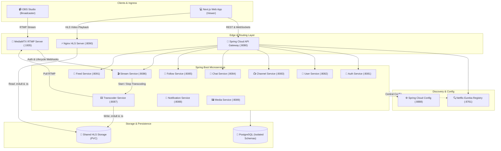
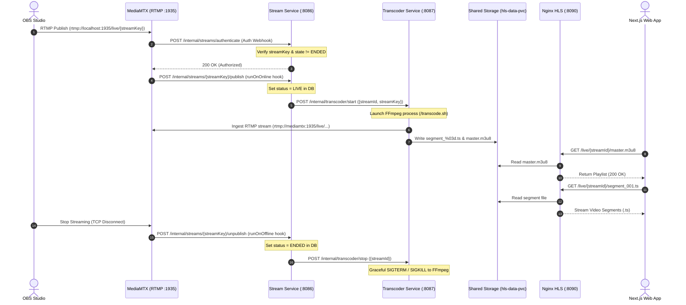

<div align="center">

# ⚡ StreamNova

### Distributed Cloud-Native Live-Streaming & Video Processing Platform

[](https://openjdk.org/)
[](https://spring.io/projects/spring-boot)
[](https://spring.io/projects/spring-cloud)
[](https://nextjs.org/)
[](https://www.typescriptlang.org/)
[](https://kubernetes.io/)
[](https://www.docker.com/)
[](https://www.postgresql.org/)

<p align="center">
  A production-ready, event-driven live streaming platform engineered with a distributed <b>Spring Boot microservices architecture</b>, real-time <b>FFmpeg adaptive HLS transcoding</b>, <b>MediaMTX RTMP ingestion</b>, <b>WebSocket/STOMP chat</b>, and a modern <b>Next.js</b> web experience.
</p>

</div>

---

## 📌 Table of Contents
- [Overview](#-overview)
- [System Architecture](#-system-architecture)
- [Video Streaming Pipeline](#-video-streaming-pipeline)
- [Microservices Ecosystem](#-microservices-ecosystem)
- [Frontend Experience](#-frontend-experience)
- [Kubernetes & Cloud Infrastructure](#-kubernetes--cloud-infrastructure)
- [Quick Start Guide](#-quick-start-guide)
  - [Prerequisites](#prerequisites)
  - [1. Start the Kubernetes Cluster](#1-start-the-kubernetes-cluster)
  - [2. Launch the Next.js Frontend](#2-launch-the-nextjs-frontend)
  - [3. Streaming via OBS Studio](#3-streaming-via-obs-studio)
- [Security Architecture](#-security-architecture)
- [Repository Structure](#-repository-structure)
- [Documentation & Resources](#-documentation--resources)

---

## 🚀 Overview

**StreamNova** is an end-to-end live broadcasting ecosystem built to handle the complexities of real-time video delivery, high-concurrency chat, and distributed microservices management:

- **Broadcasting (RTMP Ingestion):** Broadcasters stream from standard software (OBS Studio, Streamlabs) directly to MediaMTX with webhook authentication.
- **Dynamic Transcoding (FFmpeg):** Streams are automatically detected and transcoded into Apple HTTP Live Streaming (`.m3u8` playlists and 2-second `.ts` segments) with rolling window management.
- **Low-Latency Playback (HLS):** Static segments are served via an optimized Nginx server with CORS headers and browser-cached transport streams.
- **Microservices Core:** 12+ decoupled Spring Boot services orchestrated using Spring Cloud Gateway, Netflix Eureka discovery, and centralized Git configuration.
- **Real-Time Interactivity:** Sub-millisecond live chat and broadcast alerts using Spring WebSocket with STOMP & SockJS protocols.
- **Cloud-Native Deployment:** Complete Kubernetes orchestration with a single-command automated lifecycle CLI (`./k8s-cluster.sh`).

---

## 🏗 System Architecture



---

## 🎥 Video Streaming Pipeline



1. **Ingress & Authentication:** OBS connects via RTMP. MediaMTX queries `stream-service` via an HTTP webhook to validate the broadcaster's `streamKey`.
2. **Lifecycle State Transition:** When authorized, MediaMTX triggers `runOnOnline`, transitioning the stream status to `LIVE` and firing live notifications.
3. **FFmpeg Transcoding:** `transcoder-service` initiates a managed FFmpeg process that ingests the RTMP feed and generates 2-second `.ts` segments and a rolling 6-segment `master.m3u8` playlist.
4. **Shared Volume Mounting:** A Kubernetes `PersistentVolumeClaim` is mounted `ReadWrite` by the transcoder and `ReadOnly` by Nginx, eliminating network hops.
5. **Adaptive HLS Delivery:** The viewer's Next.js client consumes the stream via `hls.js` with sub-10-second end-to-end latency.

---

## 🧩 Microservices Ecosystem

| Service | Internal Port | Technology | Primary Responsibilities |
| :--- | :--- | :--- | :--- |
| **API Gateway** | `8080` | Spring Cloud Gateway | Edge routing, JWT validation, rate limiting, CORS management. |
| **Discovery Server** | `8761` | Netflix Eureka | Dynamic service registration, health monitoring, client-side load balancing. |
| **Config Server** | `8888` | Spring Cloud Config | Centralized Git-backed configuration repository. |
| **Auth Service** | `8081` | Spring Security + JWT | User authentication, token issuance, refresh token rotation, password hashing. |
| **User Service** | `8082` | Spring Data JPA | User profiles, account settings, internal identity resolution. |
| **Channel Service** | `8083` | Spring Data JPA | Channel creation, customization, banners, branding settings. |
| **Chat Service** | `8084` | Spring WebSocket + STOMP | Real-time chat rooms, message persistence, moderation controls. |
| **Follow Service** | `8085` | Spring Data JPA | Follower relationships, follower counts, feed curation hooks. |
| **Stream Service** | `8086` | Spring Data JPA | Stream lifecycle state machine, stream key generation, MediaMTX webhooks. |
| **Transcoder Service** | `8087` | Java Process + FFmpeg | Dynamic FFmpeg process lifecycle management, HLS chunk slicing. |
| **Notification Service**| `8088` | Spring WebSocket (STOMP) | Follower alerts, stream-live broadcasts, in-app notifications. |
| **Media Service** | `8089` | Spring Data JPA | Upload and storage handling for channel avatars, banners, thumbnails. |
| **Feed Service** | `8091` | Spring Data JPA | Personalized feeds, live stream discovery, category filtering. |

---

## 💻 Frontend Experience

Built with **Next.js 16 (React 19)** and **TypeScript**:

- **Adaptive Video Player:** Powered by `hls.js` supporting automatic quality switching, low-latency live synchronization, and recovery handlers.
- **Synchronized Live Chat:** Native WebSocket connection using `@stomp/stompjs` and `sockjs-client` with chat badge indicators, moderation controls, and auto-scroll.
- **Creator Dashboard:** Real-time stream key generation, copy-to-clipboard RTMP URLs, stream metadata scheduling, and live preview.
- **State & Data Fetching:** Optimized client cache using **SWR** and global client state management with **Zustand**.

---

## ☸️ Kubernetes & Cloud Infrastructure

The entire platform is orchestrated on Kubernetes (compatible with Colima, Minikube, or cloud-managed EKS/GKE):

- **Declarative Kustomize Manifests:** Located in `k8s/` with separate modular directories for infrastructure, storage, and applications.
- **Shared Persistent Storage:** Kubernetes `PersistentVolumeClaim` (`hls-data-pvc`) enables zero-latency segment sharing between transcoders and HTTP servers.
- **Optimized JVM Footprint:** Java containers run with `-Xms128m -Xmx256m -XX:MaxMetaspaceSize=128m -XX:+UseG1GC` to deliver peak efficiency across 16 simultaneous pods on developer machines.
- **Automated Lifecycle Script (`k8s-cluster.sh`):**
  - Starts Colima with optimal CPU/RAM allocation (6 cores, 12GB RAM).
  - Configures kernel inotify limits for media streaming.
  - Deploys all manifests in dependency order.
  - Automatically manages background port-forwarding to your host machine.

---

## ⚡ Quick Start Guide

### Prerequisites
- [Docker](https://www.docker.com/) & [Colima](https://github.com/abiosoft/colima) (or Minikube)
- [kubectl](https://kubernetes.io/docs/tasks/tools/)
- [Node.js 20+](https://nodejs.org/) & `npm`
- [Java 21+](https://openjdk.org/) & [Maven 3.9+](https://maven.apache.org/) (optional for local builds)
- [OBS Studio](https://obsproject.com/) (for streaming)

---

### 1. Start the Kubernetes Cluster

From the project root:

```bash
# Start cluster, apply manifests, and establish background port-forwards
./k8s-cluster.sh start
```

Verify everything is running:
```bash
./k8s-cluster.sh status
```

**Exposed Local Services:**
- 🚪 **API Gateway:** `http://localhost:8080`
- 🔍 **Eureka Dashboard:** `http://localhost:8761`
- 📡 **MediaMTX RTMP Ingress:** `rtmp://localhost:1935/live`
- ⚡ **Nginx HLS Playback:** `http://localhost:8090/live`
- 🐘 **PostgreSQL:** `localhost:5432` (`user: streaming`, `pass: streaming123`)

---

### 2. Launch the Next.js Frontend

```bash
cd frontend
npm install
npm run dev
```

Open [http://localhost:3000](http://localhost:3000) in your browser.

---

### 3. Streaming via OBS Studio

1. Open your StreamNova web dashboard and navigate to **Dashboard $\rightarrow$ Stream Settings**.
2. Copy your **Stream Key** (e.g., `sk_live_...`).
3. In **OBS Studio**:
   - Go to **Settings $\rightarrow$ Stream**.
   - **Service:** Custom...
   - **Server:** `rtmp://localhost:1935/live`
   - **Stream Key:** `<paste your stream key>`
4. Click **Start Streaming** in OBS.
5. Watch your stream go live instantly on [http://localhost:3000](http://localhost:3000)!

---

### 🛑 Stopping the Cluster

To stop all port forwards and release CPU/RAM on your host machine:

```bash
./k8s-cluster.sh stop
```

---

## 🔒 Security Architecture

- **Stateless JWT Authentication:** Short-lived access tokens signed via HMAC-SHA256 with secure refresh token rotation.
- **Service-to-Service Isolation:** Inter-service communication via internal Spring Cloud OpenFeign clients; direct external access to microservices is blocked by the API Gateway.
- **Zero Credentials in Git:** Production configurations and sensitive keys are decoupled via external environment variables, `.env.example` templates, and Kubernetes Secret abstractions.

---

## 📁 Repository Structure

```
├── backend/
│   ├── infrastructure/
│   │   ├── api-gateway/          # Edge gateway & auth filters (:8080)
│   │   ├── config-server/        # Centralized Git config server (:8888)
│   │   └── discovery-server/     # Netflix Eureka service registry (:8761)
│   └── services/
│       ├── auth-service/         # User auth, registration, JWT issuance (:8081)
│       ├── user-service/         # User profiles and management (:8082)
│       ├── channel-service/      # Channel customization & branding (:8083)
│       ├── chat-service/         # WebSocket STOMP real-time chat (:8084)
│       ├── follow-service/       # Follow/subscriber social graph (:8085)
│       ├── stream-service/       # Stream lifecycle & MediaMTX webhooks (:8086)
│       ├── transcoder-service/   # FFmpeg video chunking engine (:8087)
│       ├── notification-service/ # Real-time stream alerts & notifications (:8088)
│       ├── media-service/        # Image & avatar object storage (:8089)
│       └── feed-service/         # Aggregated discovery feeds (:8091)
├── frontend/                     # Next.js 16 + TypeScript web application
├── k8s/                          # Kubernetes manifests & Kustomize overlays
│   ├── apps/                     # Deployment & Service manifests for all apps
│   ├── infra/                    # Postgres, storage PVCs, MediaMTX, Nginx
│   └── configmap.yaml            # Cluster environment & JVM parameters
├── docker/                       # Standalone Docker Compose environments
├── docs/                         # Architectural blueprints & feature notes
├── k8s-cluster.sh                # Automated Kubernetes management CLI
├── skaffold.yaml                 # Continuous development pipeline configuration
└── README.md                     # Project documentation
```

---

## 📚 Documentation & Resources

- 📖 [Complete Architecture Guide](architecture_documentation.md) - In-depth breakdown of design patterns, databases, and microservices interactions.
- 📡 [Streaming Pipeline Documentation](docs/streaming_pipeline_architecture.md) - Sequence diagrams, FFmpeg parameters, and segment storage topology.
- 📑 [REST API Documentation](api_documentation.md) - Complete endpoint references, request/response models, and status codes.

---

## 👨‍💻 Author

**Karan Jaswani**  
- GitHub: [@KaranPushes](https://github.com/KaranPushes)  
- LinkedIn: [in/karan-jaswani](https://linkedin.com/in/karan-jaswani)

---

<div align="center">
  <sub>Engineered with precision for modern distributed media architectures.</sub>
</div>
