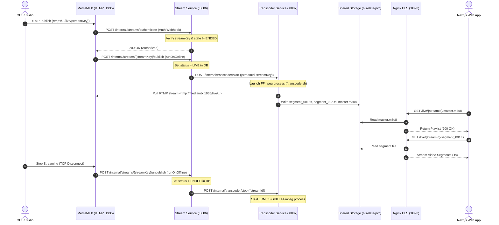

# StreamNova Streaming Pipeline Architecture Documentation

## 1. Executive Summary & Overview
The **StreamNova** streaming pipeline is a cloud-native, distributed video ingestion and delivery engine designed to ingest live RTMP streams from broadcast software (e.g., OBS Studio), validate stream integrity in real-time, transcode raw video streams into Apple HTTP Live Streaming (HLS) formats via FFmpeg, and deliver them globally to Next.js clients with low latency and adaptive playback.

```
+----------------+       RTMP        +------------------+    Shared PVC     +-----------------+      HLS (HTTP)     +--------------------+
|   OBS Studio   | --------------->  |     MediaMTX     | -------------->   |    Nginx HLS    | ----------------->  |   Next.js Client   |
|   (Broadcaster)|   :1935/live/key  |   (RTMP Server)  |   /var/www/hls    | (Media Server)  |  :8090/live/...     | (hls.js / VideoJS) |
+----------------+                   +------------------+   /usr/share/nginx+-----------------+                     +--------------------+
                                            |   ^                                    ^
                             Webhook Auth & |   | Feign REST                         |
                             Publish Events |   | Start/Stop                         |
                                            v   |                                    |
                                     +-------------------+                  +--------------------+
                                     |   Stream Service  | ---------------> | Transcoder Service |
                                     |    (Lifecycle)    |   Transcode Pod  |  (FFmpeg Engine)   |
                                     +-------------------+                  +--------------------+
```

---

## 2. Complete End-to-End Pipeline Workflow

### Step 1: Stream Scheduling & Key Generation
1. Broadcasters initiate a stream session via the Next.js frontend, sending `POST /api/v1/streams` through **Spring Cloud API Gateway** (`:8080`).
2. **Stream Service** (`:8086`) generates a cryptographically secure, unique `streamKey` (e.g., `sk_live_...`) and registers a new stream entity in the **PostgreSQL** database with status `SCHEDULED`.
3. The stream key and RTMP URL (`rtmp://localhost:1935/live`) are returned to the broadcaster to configure their broadcast client (OBS Studio).

### Step 2: RTMP Ingress & In-line Authentication
1. Broadcaster clicks **"Start Streaming"** in OBS. OBS opens an RTMP socket connection to **MediaMTX** on port `1935` (`rtmp://localhost:1935/live/<streamKey>`).
2. MediaMTX intercepts the handshake and triggers a synchronous HTTP authentication webhook:
   - **Endpoint**: `POST http://stream-service:8086/internal/streams/authenticate`
   - **Payload**: `{ "action": "publish", "path": "live/<streamKey>", "protocol": "rtmp" }`
3. **Stream Service** validates the key against PostgreSQL:
   - If valid and stream status is not `ENDED`, it returns `200 OK`.
   - If invalid or expired, it returns `401 Unauthorized` / `404 Not Found`, and MediaMTX abruptly terminates the OBS TCP connection.

### Step 3: Stream Activation & Lifecycle Transition
1. Upon successful connection establishment, MediaMTX triggers its `runOnOnline` event hook:
   - Command: `curl -X POST http://stream-service:8086/internal/streams/$G1/publish`
2. **Stream Service** handles the transition:
   - Updates stream status in PostgreSQL to `LIVE` and marks `startedAt = Instant.now()`.
   - Sends a notification to **Notification Service** (`notifyStreamLive`) to alert followers.
   - Dispatches a REST invocation via Spring Cloud OpenFeign to **Transcoder Service** (`:8087`):
     ```json
     POST http://transcoder-service:8087/internal/transcoder/start
     {
       "streamId": "550e8400-e29b-41d4-a716-446655440000",
       "streamKey": "sk_live_9f8d7b6a"
     }
     ```

### Step 4: Transcoding & HLS Chunk Generation
1. **Transcoder Service** executes `/transcode.sh` inside its Kubernetes Pod:
   - Pulls raw stream from MediaMTX: `rtmp://mediamtx:1935/live/${STREAM_KEY}`
   - Prepares output target on shared storage: `/var/www/hls/${STREAM_ID}/`
2. **FFmpeg Engine Execution**:
   ```bash
   ffmpeg \
       -fflags +genpts \
       -i "$INPUT" \
       -map 0:v -map 0:a \
       -c:v copy \
       -c:a copy \
       -f hls \
       -hls_time 2 \
       -hls_list_size 6 \
       -hls_flags delete_segments+independent_segments \
       -hls_segment_filename "$OUTPUT/segment_%03d.ts" \
       "$OUTPUT/master.m3u8"
   ```
   - Chunks live video stream into 2-second Transport Stream (`.ts`) fragments.
   - Continuously regenerates rolling index file `master.m3u8` keeping the last 6 segments active for low playback latency (~6–10s target glass-to-glass latency).
   - Writes directly to **Kubernetes PersistentVolumeClaim** (`hls-data-pvc`).

### Step 5: High-Performance HLS Content Delivery
1. **Nginx Media Pod** mounts the same `hls-data-pvc` in `readOnly` mode at `/usr/share/nginx/html`.
2. Serves static video chunks over HTTP on port `8090` (`http://localhost:8090/live/{streamId}/master.m3u8`).
3. **Nginx optimizations**:
   - `Cache-Control: no-cache` for `.m3u8` playlists so clients instantly receive newly generated chunks.
   - `Cache-Control: public, max-age=3600` for `.ts` media segments since video chunk data is immutable.
   - Full CORS wildcard headers (`Access-Control-Allow-Origin: *`) allowing Next.js web applications to request chunks cross-origin.

### Step 6: Client Playback & Real-time Interactivity
1. The **Next.js** web application uses `hls.js` inside an HTML5 `<video>` tag:
   - Polls `http://localhost:8090/live/{streamId}/master.m3u8`.
   - Downloads sequential `.ts` segments and feeds them into browser MediaSource Extensions (MSE).
2. Concurrently connects to **Chat Service** over WebSocket (`/ws/chat` via SockJS + STOMP) to receive and send chat messages synchronized with the live stream.

### Step 7: Teardown & Unpublish Lifecycle
1. Broadcaster stops streaming in OBS. MediaMTX detects EOF and fires the `runOnOffline` hook:
   - Command: `curl -X POST http://stream-service:8086/internal/streams/$G1/unpublish`
2. **Stream Service**:
   - Updates status in DB to `ENDED` and sets `endedAt = Instant.now()`.
   - Calls `POST http://transcoder-service:8087/internal/transcoder/stop`.
3. **Transcoder Service**:
   - Halts the running FFmpeg process (`Process.destroy()` / `destroyForcibly()`), freeing CPU and memory.

---

## 3. Detailed Sequence Diagram



---

## 4. Kubernetes Infrastructure Topology

```mermaid
graph TD
    subgraph Host Network / Ingress
        OBS["OBS Studio (RTMP)"]
        Browser["Next.js Browser (HLS & APIs)"]
    end

    subgraph Kubernetes Cluster (Colima)
        subgraph Ports & Services
            IngressPort["Port-Forward :8080 (API Gateway)"]
            RTMPPort["Port-Forward :1935 (MediaMTX RTMP)"]
            HLSPort["Port-Forward :8090 (Nginx HLS)"]
        end

        subgraph Ingestion & Media Pods
            MTXPod["MediaMTX Pod (:1935, :8554, :8888)"]
            TranscoderPod["Transcoder Pod (:8087) + FFmpeg"]
            NginxPod["Nginx HLS Pod (:80)"]
        end

        subgraph Spring Cloud Microservices
            Discovery["Discovery Server (Eureka :8761)"]
            Gateway["API Gateway (:8080)"]
            StreamPod["Stream Service (:8086)"]
            ChatPod["Chat Service (:8084)"]
            AuthPod["Auth Service (:8081)"]
            OtherPods["Channel, Media, Feed, etc."]
        end

        subgraph Persistent Volumes
            HLSPVC[("hls-data-pvc (5Gi RW)")]
            PostgresPVC[("postgres-pvc (PostgreSQL 16)")]
        end
    end

    OBS -->|RTMP Stream| RTMPPort --> MTXPod
    Browser -->|HTTP/REST| IngressPort --> Gateway
    Browser -->|HLS Video| HLSPort --> NginxPod

    MTXPod -->|Webhooks| StreamPod
    StreamPod -->|Start / Stop| TranscoderPod
    TranscoderPod -->|Pull RTMP| MTXPod
    TranscoderPod -->|Write Chunks| HLSPVC
    NginxPod -->|Read Chunks| HLSPVC
    StreamPod --> PostgresPVC
    Gateway --> Discovery
    StreamPod --> Discovery
    TranscoderPod --> Discovery
```

---

## 5. Key Architecture Decisions & Specifications

| Component | Technology | Role & Key Configuration |
| :--- | :--- | :--- |
| **Ingress Media Server** | MediaMTX (`bluenviron/mediamtx:1-ffmpeg`) | Standalone zero-latency RTMP server. Configured with HTTP webhook auth (`authHTTPAddress`) and lifecycle hooks (`runOnOnline`, `runOnOffline`). |
| **Transcoding Engine** | FFmpeg 6.x on Alpine Linux | Packaged in `streamnova/transcoder-service`. Slices raw stream into 2s `.ts` files with `-hls_flags delete_segments+independent_segments` to maintain an active rolling playlist of 6 chunks. |
| **Shared Storage** | Kubernetes PVC (`hls-data-pvc`) | Mounted by Transcoder (ReadWrite) at `/var/www/hls` and by Nginx (ReadOnly) at `/usr/share/nginx/html`. Eliminates network hops for segment storage. |
| **HLS Web Server** | Nginx Alpine (`nginx:alpine`) | High-performance reverse proxy with CORS headers enabled, `no-cache` for `.m3u8` playlists, and HTTP chunk caching for `.ts` segments. |
| **Stream Lifecycle Controller** | Spring Boot (`stream-service`) | Manages stream state machine (`SCHEDULED` $\rightarrow$ `LIVE` $\rightarrow$ `ENDED`), authenticates keys, and triggers FFmpeg orchestration pods. |
| **Client Player** | Next.js (React 19) + `hls.js` | Adaptive streaming playback engine that handles video buffer synchronization, error recovery, and seamless playback. |
